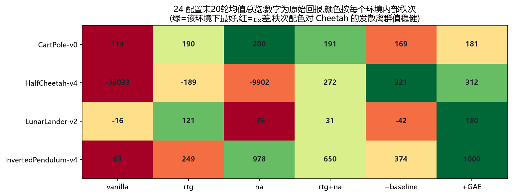
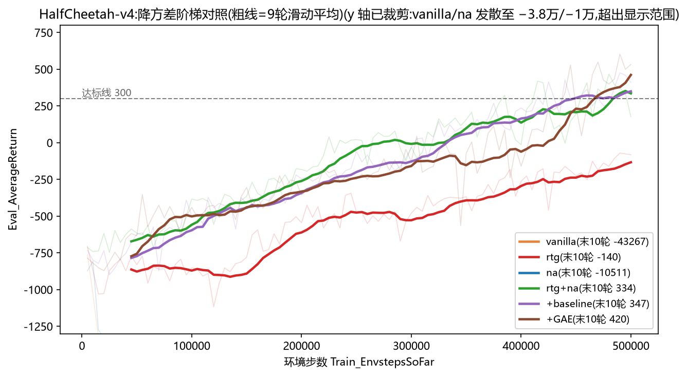
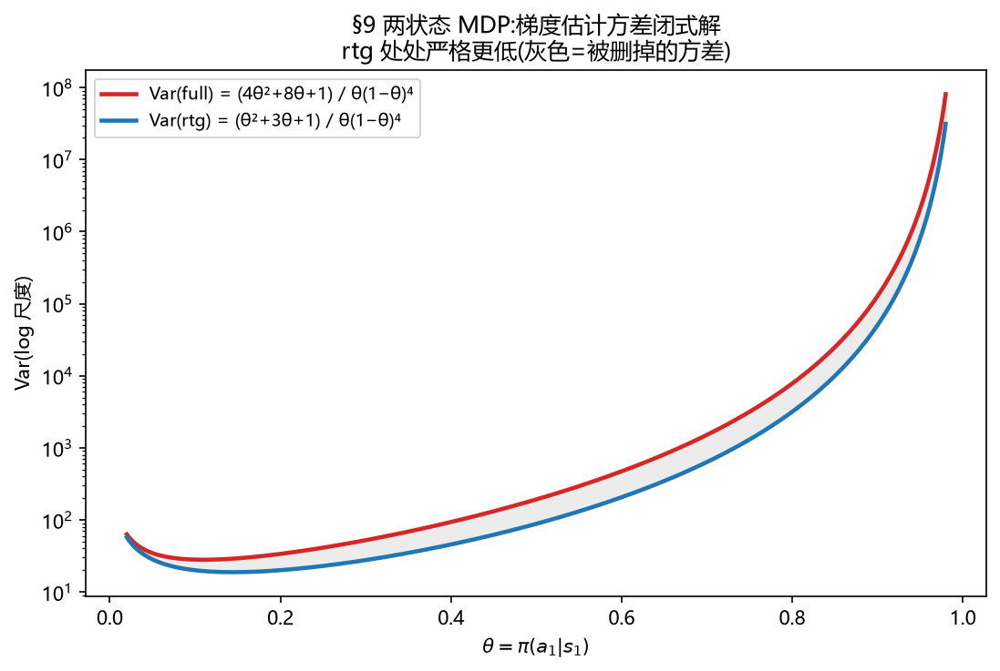

# HW2 · Policy Gradients:方差控制(第 2 讲)

> 在"RL 的四种失败"世界观里,本讲是 **失败 II · 方差**。

> 核心问题:REINFORCE 的梯度估计**无偏**——那它为什么还会失败?
> 本讲所有技术只改 ĝ = Σ_t ∇log π(a_t|s_t)·w_t 里的标量权重 w_t。哪一件重要,在哪里重要?

**官方地图**:CS285 Lec 4–6(policy gradients / actor-critic)+ HW2 作业 PDF。
**深度分析(中文,33 次训练运行)**:见 `docs/hw2_analysis.html`(仓库根 docs/)。

## 方差阶梯(每级只加一个机制)

```
vanilla → reward-to-go → advantage-normalize → +baseline → +GAE(λ)
```

| 环境 | 关键结果 | 结论 |
|---|---|---|
| CartPole-v0(2×2×2) | `na` 单件即满分(末 10 轮 200);b=4000 时**四配置全满分** | 大 batch 买稳定,小 batch 买样本效率;na 在全正奖励下≈免费 baseline |
| HalfCheetah-v4 | baseline:−140 → **347**;削弱 critic(bgs 5→1)同步退化 | baseline 去状态混淆,是长 horizon 能学的前提 |
| LunarLander-v2 | GAE λ∈{0,.95,.98,.99,1}:**λ=0.99 → 180**;λ→0 学不动,中间 λ 后期塌陷 | λ 是偏差-方差旋钮;最差组合是"两边都没压好" |

## 自选 24 配置矩阵(6 估计器 × 4 环境,超出作业要求)



- `vanilla` 在 HalfCheetah **发散到 −38,033**(不是没学会,是爆了):所有动作被同号巨额回报无差别推高;
- `na` 单独(无 rtg)同样崩到 −1 万:**中心化救不了 T² 量级的配对噪声——rtg 是防爆底线,不是可选件**;
- LunarLander 上"同一估计器、同一种子"因求值顺序不同跑出 −42 vs 148:**混沌分岔**,单 seed 定量结论不可信。



## 理论 ↔ 实践

两状态 MDP 闭式方差:Var_full = (4θ²+8θ+1)/θ(1−θ)⁴,Var_rtg = (θ²+3θ+1)/θ(1−θ)⁴——
同分母,分子差恒正,rtg 处处严格更低;IS 修正方差随 horizon 指数爆炸(→ HW3 为什么必须换路线)。



## 复现

```bash
pip install -e . --no-deps
python cs285/scripts/run_hw2.py --env_name HalfCheetah-v4 -n 100 -b 5000 -rtg \
  --discount 0.95 -lr 0.01 --use_baseline -blr 0.01 -bgs 5
# 图表复现:python report/build_report.py(读取 data/logs/*.log)
```

## 自测

1. baseline 会不会让梯度期望有偏?(不会:E[∇logπ·b(s)] = 0,只减方差)
2. 为什么 GAE λ=1 时退化为 reward-to-go 减 baseline?(δ 级数望远镜坍缩)
3. CartPole 上 na 为何近似免费 baseline?(全正奖励的中心化:坏动作真正被压低)
